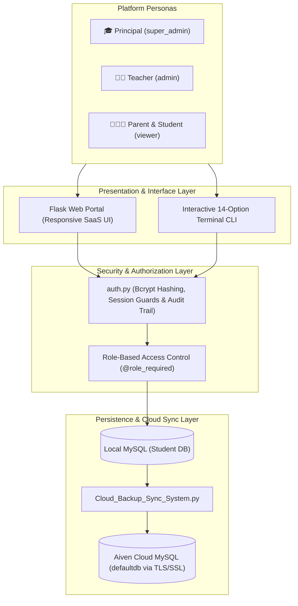

<div align="center">

# 🎓 EduPulse &mdash; School Management System
### Modern, Enterprise-Ready School & Academic Management Platform (Web & Terminal CLI)

[](https://www.python.org/)
[](https://flask.palletsprojects.com/)
[](https://www.mysql.com/)
[](https://aiven.io/)
[](https://pypi.org/project/bcrypt/)
[](LICENSE)

<p align="center">
  <a href="#-key-features">Key Features</a> •
  <a href="#-role-access-matrix">Role Matrix</a> •
  <a href="#-quick-start">Quick Start</a> •
  <a href="#-initial-account-setup--authentication">Account Setup</a> •
  <a href="#-project-architecture">Architecture</a> •
  <a href="#-database-schema">Database</a> •
  <a href="#-cloud-replication">Cloud Sync</a> •
  <a href="#-automated-testing">Testing</a>
</p>

</div>

---

## 📖 About The Project

**EduPulse** is a full-stack, enterprise-grade **School & Academic Management System** designed to streamline institutional administration, teacher workflows, and parent-student engagement. Built with **Python 3, Flask, and MySQL**, it pairs an intuitive **Navy-Blue Light Theme SaaS Web Interface** with a modular **14-Option Interactive Terminal CLI**.

The system implements a true **dual-tier database architecture**: a local MySQL engine for instant daily school operations paired with live TLS/SSL encrypted replication to **Aiven Cloud MySQL** for cloud backups and multi-device access.

### 🏛️ System Architecture



---

## ✨ Key Features

* 🔐 **Role-Based Access Control (RBAC)**: Distinct permissions for **Principal**, **Teachers**, and **Parents & Students**.
* 📝 **User Self-Registration**: New faculty and parents can register their own accounts with real-time password strength enforcement. Principal accounts are strictly protected from self-registration.
* 🎓 **Academics & E-Learning LMS**: Assignment publishing, student work turn-in, teacher evaluation with letter grades/feedback, syllabus PDF distribution, and interactive timed quizzes with instant scoring.
* 📚 **Library Circulation & Fines**: Book inventory catalog, issue/return desk, loan countdowns, automated overdue fines (₹5/day), and book reservation queues.
* 🏥 **Student Health & Clinic Logs**: Medical profiles (blood group, allergies, chronic ailments), infirmary visit triage logs, and nurse outcome notes.
* ⚖️ **Behavioral Discipline & Counseling**: Incident reporting by severity (`Minor`, `Moderate`, `Major`, `Critical`) and counselor follow-up action plans.
* 🤝 **Parent-Teacher Meetings (PTM)**: Faculty-published consultation slots with online 1-on-1 parent booking and conference advice logs.
* 📈 **Performance Analytics & Support Desk**: Multi-term student progression trajectories (`Improving`, `Stable`, `Declining`), subject struggle diagnostics, and early-warning at-risk student registry.
* 💳 **Fee Management & Financial Privacy**: Principal oversees school-wide revenue collections. Parents and students view verified payment receipts and clearing status. Teachers are strictly restricted from financial data.
* 🎂 **Institutional Birthday Corner**: Real-time detection of student and faculty birthdays occurring today or within the next 30 days.
* ☁️ **Aiven Cloud MySQL Mirroring**: 1-click on-demand or automated synchronization of all 32 tables and 600+ records over secure TLS/SSL.
* 💻 **14-Option Interactive CLI**: Complete terminal interface mirroring every web feature for system administrators.

---

## 👥 Role Access Matrix

| Platform Area | 🎓 Principal (`super_admin`) | 👨‍🏫 Teacher (`admin`) | 👨‍👩‍👧 Parent & Student (`viewer`) |
| :--- | :---: | :---: | :---: |
| **Dashboard & Notice Board** | Full Overview | Academic Overview | Student Progress & Circulars |
| **Student Directory** | Full CRUD & Enroll | Full CRUD & Enroll | Read-Only Directory |
| **Faculty Management** | Full CRUD & Enroll | View Directory | View Directory |
| **Parent & Guardian Directory** | Full CRUD | View Contact Info | ❌ **Access Denied (Privacy Guard)** |
| **Coursework & LMS** | Full Management | Publish & Grade Work | **Turn In Homework & Take Quizzes** |
| **Examinations & Marks** | Full Management | Record & Edit Scores | **View Report Cards & Grades** |
| **Classroom Attendance** | Full Oversight | Mark Daily Attendance | **View Attendance % & Absences** |
| **Academic Calendar & Events** | Create & Manage | View & Participate | **View Events & Term Breaks** |
| **PTM Consultations** | Full Oversight | Publish Slots & Notes | **Book 1-on-1 Consultation Slots** |
| **Library Circulation** | Catalogue & Fines | Issue & Return Desk | **Browse Catalogue & Reserve Books** |
| **Health & Infirmary Records** | Full Oversight | Refer to Infirmary | **View Health Profile & Clinic Visits** |
| **Discipline & Counseling** | Full Oversight | Report Infractions | **View Child's Action Plans** |
| **Fee Management** | Institutional Ledger (₹) | ❌ **Access Denied (HTTP 302)** | **View Personal Receipts & Dues** |
| **User & Role Accounts** | Full Provisioning | ❌ **Access Denied (HTTP 302)** | ❌ **Access Denied (HTTP 302)** |
| **Aiven Cloud Live Sync** | Full Replication | ❌ **Access Denied (HTTP 302)** | ❌ **Access Denied (HTTP 302)** |

---

## 🚀 Quick Start

### 1. Prerequisites
* **Python 3.9+** ([Download](https://www.python.org/downloads/))
* **MySQL Server 8.0+** running locally on port `3306`
* Optional: **Aiven Cloud MySQL** service for remote cloud sync

### 2. Clone the Repository
```bash
git clone https://github.com/your-username/edupulse-school-management-system.git
cd edupulse-school-management-system
```

### 3. Create & Activate Virtual Environment
* **Windows (PowerShell)**:
  ```powershell
  python -m venv venv
  .\venv\Scripts\Activate.ps1
  ```
* **Linux / macOS**:
  ```bash
  python3 -m venv venv
  source venv/bin/activate
  ```

### 4. Install Dependencies
```bash
pip install -r requirements.txt
```

### 5. Configure Environment Variables
Copy `.env.example` to `.env`:
* **Windows**: `copy .env.example .env`
* **Linux / macOS**: `cp .env.example .env`

Edit `.env` with your MySQL credentials:
```ini
# Local Database Configuration
DB_HOST=localhost
DB_USER=root
DB_PASSWORD=your_local_mysql_password
DB_NAME=Student
DB_PORT=3306

# Flask Session Key
FLASK_SECRET_KEY=your_generated_secret_key_here

# (Optional) Aiven Cloud MySQL Configuration
AIVEN_DB_HOST=mysql-your-subdomain.aivencloud.com
AIVEN_DB_PORT=23236
AIVEN_DB_USER=avnadmin
AIVEN_DB_PASSWORD=your_aiven_cloud_password
AIVEN_DB_NAME=defaultdb
AIVEN_DB_SSL_MODE=REQUIRED
```

> [!WARNING]
> **Never commit your `.env` file to GitHub!** It contains sensitive database passwords and session secret keys. The repository `.gitignore` is already pre-configured to exclude `.env`, `exports/`, and SQL dumps.

### 6. Initialize Database & Run

#### Option A: Web Application (Flask)
```bash
python app.py
```
Open your browser and navigate to:
👉 **`http://127.0.0.1:5000`**

#### Option B: Terminal CLI Interface
```bash
python Main.py
```

---

## 🔐 Initial Account Setup & Authentication

EduPulse uses **Bcrypt** cryptographic password hashing with granular **Role-Based Access Control (RBAC)**. To prevent security vulnerabilities on public repositories and production servers, **no default passwords or administrative credentials are hardcoded into production**.

### 1. First-Run Administrator Initialization
Upon deploying or running the application on a fresh database:
1. Navigate to **`http://127.0.0.1:5000/login`** (or your hosted domain).
2. The system automatically detects that no administrator exists (`first_run=True`) and displays the **First-Run Setup Screen**.
3. Create your custom **Principal / Super-Admin** account with your desired username and a strong password meeting standard complexity rules (minimum 8 characters, uppercase, and digit).

### 2. Role-Based Self-Registration
- **Teachers** and **Parents/Students** can register their own accounts directly via the **"Create Account"** tab on `/login`.
- Accounts are created securely with immediate role scoping (`admin` for Teachers, `viewer` for Parents & Students).
- The Principal can also provision, inspect, or manage user accounts from the **User Management** portal (`/users`).

### 3. Local Development Quick-Logins (Optional)
For local testing and offline evaluation, 1-click test credential pills can be conditionally enabled by setting in your local `.env`:
```env
ENABLE_DEMO_LOGINS=true
```
> [!IMPORTANT]
> **Production & Deployment Security**: Always keep `ENABLE_DEMO_LOGINS=false` (the default) on live deployments (such as Render, Railway, or AWS) and never commit your real `.env` file to GitHub.

---

## 📂 Project Structure

```text
Student_Management_system/
│
├── app.py                              # Flask Web Server, Controllers & RBAC Routes
├── auth.py                             # Authentication, Bcrypt Hashing, RBAC Decorators & Audit Log
├── utils.py                            # Database Connection Helper & Input Validators
├── Cloud_Backup_Sync_System.py         # Aiven Cloud MySQL TLS/SSL Replication Engine
├── .env.example                        # Template for Environment Variables (Safe for Git)
├── .gitignore                          # Excludes .env, exports, *.sql, cache & virtual environments
├── requirements.txt                    # Project Python Dependencies
├── README.md                           # Master GitHub Documentation
│
├── static/                             # Web Portal Assets
│   └── css/
│       └── style.css                   # Custom Navy-Blue Light Theme SaaS Stylesheet
│
├── templates/                          # Jinja2 HTML5 Templates
│   ├── base.html                       # Base Layout (Responsive Sidebar, Topbar Navigation)
│   ├── login.html                      # Sign In & Self-Registration Tabs (Environment-Gated Demo Mode)
│   ├── dashboard.html                  # Role-Tailored Dashboard, KPIs, Charts & Spaced Action Hub
│   ├── students.html                   # Student Directory with Search, Class Filter & Edit Modal
│   ├── teachers.html                   # Faculty Directory with Subject Filter & Profile Modals
│   ├── parents.html                    # Parent & Guardian Directory (Privacy Protected)
│   ├── users.html                      # Principal User Management & Live Audit Trail
│   ├── change_password.html            # Password Update Interface with Policy Checklist
│   ├── library.html                    # Library Catalogue, Circulation, Fines & Holds Queue
│   ├── coursework.html                 # Academics LMS: Assignments, Submissions, Materials, Quizzes
│   ├── health_discipline.html          # Infirmary Visits, Medical Profiles, Discipline & Counseling
│   ├── calendar_ptm.html               # School Calendar, Holidays, Events & 1-on-1 PTM Bookings
│   ├── performance_analytics.html      # Multi-Term Trajectories, Struggle Diagnostics & Support Desk
│   ├── cloud_sync.html                 # Aiven Cloud MySQL Live Replication & Latency Monitor
│   ├── attendance.html                 # Classroom Daily Attendance Logs
│   ├── fees.html                       # Fee Transactions Ledger & Student Payment Receipts
│   └── exams.html                      # Examination Records & Evaluation Marks
│
├── Main.py                             # Standalone Interactive 14-Option Terminal CLI
├── Student_Manegement_System.py        # CLI Student CRUD Module
├── Teacher_Management_System.py        # CLI Teacher Operations Module
├── Parent_Management_System.py         # CLI Parent & Guardian Module
├── Library_Management_System.py        # CLI Library Circulation & Fines Module
├── Coursework_Management_System.py     # CLI Coursework, Assignments & Quizzes Module
├── Health_Discipline_Management_System.py # CLI Health, Clinic & Discipline Module
├── Calendar_PTM_Management_System.py   # CLI School Calendar & PTM Module
├── Analytics_Management_System.py      # CLI Performance Analytics & Matplotlib Visualizer
├── FeeFinance_Management_System.py     # CLI Fee & Financial Records Module
├── ExamMarks_Management_System.py      # CLI Examination & Merit Ranking Module
├── Attendance_Management_System.py     # CLI Attendance Module
├── Export_Management_System.py         # CLI CSV & Excel Exporter
└── Import_Management_System.py         # CLI Bulk CSV Importer
```

---

## 🗄️ Database Schema

The database features **32 relational tables** organized across functional domains:

<details>
<summary><b>Click to expand full 32-table database schema breakdown</b></summary>

```sql
-- 1. Core Users & System History
users (ID, USERNAME, PASSWORD, ROLE)
history (ID, USERNAME, ACTIONS, LOG_TIME)

-- 2. People & Family Registry
Students_Details (ID, ROLL_NUMBER, NAME, CLASS, AGE, ADDRESS, PHONE, EMAIL, GENDER, DOB)
Teachers_Details (ID, TEACHER_ID, NAME, SUBJECT, AGE, ADDRESS, PHONE, EMAIL, GENDER, DOB)
Parents_Details (ID, ROLL_NUMBER, FATHER_NAME, FATHER_OCCUPATION, FATHER_PHONE, MOTHER_NAME, MOTHER_OCCUPATION, MOTHER_PHONE, GUARDIAN_NAME, RELATION, PRIMARY_CONTACT, EMAIL, RESIDENTIAL_ADDRESS, EMERGENCY_CONTACT, ANNUAL_INCOME)

-- 3. Academic LMS & Coursework
Assignments (ID, ASSIGNMENT_CODE, TITLE, SUBJECT, CLASS, TEACHER_NAME, DUE_DATE, MAX_MARKS, DESCRIPTION, REFERENCE_URL, STATUS, CREATED_AT)
Assignment_Submissions (ID, SUBMISSION_CODE, ASSIGNMENT_CODE, ROLL_NUMBER, STUDENT_NAME, SUBMISSION_DATE, SOLUTION_TEXT, PROJECT_URL, MARKS_AWARDED, GRADE, TEACHER_FEEDBACK, GRADED_BY, STATUS)
Study_Materials (ID, MATERIAL_CODE, TITLE, SUBJECT, CLASS, FILE_TYPE, MATERIAL_URL, UPLOADED_BY, UPLOAD_DATE, DESCRIPTION)
Learning_Courses (ID, COURSE_CODE, COURSE_NAME, SUBJECT, TARGET_CLASS, DURATION_WEEKS, LESSON_COUNT, LEVEL, SYLLABUS_OUTLINE, INSTRUCTOR_NAME)
Online_Quizzes (ID, QUIZ_CODE, TITLE, SUBJECT, TARGET_CLASS, DURATION_MINS, PASSING_PCT, STATUS, CREATED_BY)
Quiz_Questions (ID, QUIZ_CODE, QUESTION_NUMBER, QUESTION_TEXT, OPTION_A, OPTION_B, OPTION_C, OPTION_D, CORRECT_OPTION, MARKS)
Quiz_Attempts (ID, ATTEMPT_CODE, QUIZ_CODE, ROLL_NUMBER, STUDENT_NAME, SCORE_OBTAINED, TOTAL_SCORE, PERCENTAGE, IS_PASSED, ATTEMPT_DATE)

-- 4. Library Circulation & Fines
Books_Details (ID, BOOK_ID, TITLE, AUTHOR, GENRE, TOTAL_COPIES, AVAILABLE_COPIES, ISBN, PUBLISHER, SHELF_LOCATION)
Book_Issues (ID, ISSUE_CODE, BOOK_ID, BORROWER_TYPE, BORROWER_ID, BORROWER_NAME, ISSUE_DATE, DUE_DATE, RETURN_DATE, STATUS, FINE_AMOUNT, FINE_STATUS)
Book_Reservations (ID, RESERVATION_CODE, BOOK_ID, BORROWER_TYPE, BORROWER_ID, BORROWER_NAME, RESERVATION_DATE, STATUS, NOTIFIED_DATE)

-- 5. Student Health & Behavioral Discipline
Student_Health_Profiles (ID, ROLL_NUMBER, BLOOD_GROUP, ALLERGIES, CHRONIC_CONDITIONS, ROUTINE_MEDS, PHYSICIAN_CONTACT, INSURANCE_POLICY, EMERGENCY_INSTRUCTIONS, LAST_UPDATED)
Medical_Room_Visits (ID, VISIT_CODE, ROLL_NUMBER, VISIT_DATE, VISIT_TIME, SYMPTOMS, DIAGNOSIS, TREATMENT_GIVEN, ATTENDING_STAFF, PARENT_NOTIFIED, OUTCOME, CONFIDENTIAL_NOTES)
Discipline_Incidents (ID, INCIDENT_CODE, ROLL_NUMBER, INCIDENT_DATE, INCIDENT_TIME, SEVERITY, INCIDENT_TYPE, LOCATION, REPORTED_BY, DESCRIPTION, WITNESS_NAMES, ACTION_TAKEN, STATUS)
Discipline_Followups (ID, FOLLOWUP_CODE, INCIDENT_CODE, FOLLOWUP_DATE, COUNSELOR_NAME, ACTION_PLAN, PARENT_MEETING_DATE, PARENT_UNDERTAKING, STATUS, REMARKS)

-- 6. School Calendar & PTM System
School_Holidays (ID, TITLE, START_DATE, END_DATE, TOTAL_DAYS, HOLIDAY_TYPE, DESCRIPTION)
School_Events (ID, EVENT_CODE, TITLE, EVENT_DATE, START_TIME, END_TIME, CATEGORY, LOCATION, TARGET_AUDIENCE, STATUS, DESCRIPTION)
PTM_Meeting_Slots (ID, SLOT_CODE, TEACHER_ID, TEACHER_NAME, SUBJECT, SLOT_DATE, START_TIME, END_TIME, MEETING_MODE, ROOM_OR_LINK, STATUS)
PTM_Bookings (ID, BOOKING_CODE, SLOT_CODE, ROLL_NUMBER, STUDENT_NAME, PARENT_NAME, PARENT_PHONE, AGENDA_TOPIC, STATUS, TEACHER_FEEDBACK_NOTES)
Calendar_Reminders (ID, REMINDER_CODE, TITLE, REMINDER_DATE, REMINDER_TIME, TARGET_ROLE, MESSAGE_TEXT, STATUS)

-- 7. Performance Analytics & Interventions
Academic_Interventions (ID, INTERVENTION_CODE, ROLL_NUMBER, RISK_LEVEL, IDENTIFIED_TERM, SUBJECT_STRUGGLE, ACTION_PLAN, ASSIGNED_MENTOR, STATUS, CREATED_AT, UPDATED_AT)

-- 8. Attendance, Examinations & Finance
Attendance_Details (ID, ROLL_NUMBER, ATTENDANCE_DATE, STATUS, REMARKS)
Marks_Details (ID, ROLL_NUMBER, EXAM_TYPE, SUBJECT, MARKS_OBTAINED, MAX_MARKS)
Fee_Transactions (RECEIPT_NO, ROLL_NUMBER, AMOUNT_PAID, PAYMENT_DATE, PAYMENT_MODE, REMARKS)
announcements (ID, TITLE, CATEGORY, DESCRIPTION, POST_DATE, PRIORITY)
academic_events (ID, TITLE, EVENT_DATE, CATEGORY, LOCATION)
```
</details>

---

## 🌐 Web Routes Reference

<details>
<summary><b>Click to expand web route endpoints & permissions reference</b></summary>

| Route | HTTP Method | Permitted Roles | Description |
| :--- | :---: | :---: | :--- |
| `/login` | `GET`, `POST` | Public | Authentication portal with dual tabs (Sign In & Create Account). |
| `/register` | `GET`, `POST` | Public | Self-registration endpoint for Teachers and Parents/Students. |
| `/logout` | `GET` | Authenticated | Signs out user, invalidates session, and writes an audit log. |
| `/change-password` | `GET`, `POST` | Authenticated | Updates account password with strength policy verification. |
| `/` or `/dashboard` | `GET` | Authenticated | Role-adaptive dashboard with KPIs, Chart.js, Birthdays, and Quick Action Hub. |
| `/students` | `GET` | Authenticated | Paginated student directory with text search and class filter. |
| `/students/add` | `POST` | `super_admin`, `admin` | Enrolls a new student with unique roll number validation. |
| `/students/edit/<id>` | `POST` | `super_admin`, `admin` | Updates student demographic and class details. |
| `/students/delete/<id>` | `POST` | `super_admin`, `admin` | Removes student record with cascade cleanup. |
| `/teachers` | `GET` | Authenticated | Faculty directory with subject filter and contact details. |
| `/teachers/add` | `POST` | `super_admin`, `admin` | Registers a new faculty instructor. |
| `/teachers/edit/<id>` | `POST` | `super_admin`, `admin` | Updates faculty subject assignment and details. |
| `/teachers/delete/<id>` | `POST` | `super_admin`, `admin` | Removes a faculty profile. |
| `/parents` | `GET` | `super_admin`, `admin` | Parent & guardian directory (strictly blocked for `viewer` to protect privacy). |
| `/parents/add` | `POST` | `super_admin`, `admin` | Links parent/guardian information to an enrolled student. |
| `/parents/edit/<id>` | `POST` | `super_admin`, `admin` | Updates parent contacts, emergency numbers, and occupations. |
| `/users` | `GET` | `super_admin` | Principal user provisioning console and full system audit history trail. |
| `/users/add` | `POST` | `super_admin` | Provisions accounts for Teachers or Parents/Students. |
| `/users/delete/<id>` | `POST` | `super_admin` | Deletes a user account (prevents self-deletion). |
| `/coursework` | `GET` | Authenticated | LMS hub: Assignments, Submissions, Materials, Courses, and Quizzes. |
| `/coursework/assignments/add` | `POST` | `super_admin`, `admin` | Publishes a new curriculum homework assignment. |
| `/coursework/submissions/submit` | `POST` | Authenticated | Student turns in homework solution text or project link. |
| `/coursework/submissions/grade/<id>` | `POST` | `super_admin`, `admin` | Faculty awards marks, letter grades, and written feedback. |
| `/coursework/materials/add` | `POST` | `super_admin`, `admin` | Uploads lecture notes and study reference links. |
| `/coursework/courses/add` | `POST` | `super_admin`, `admin` | Catalogs a structured learning course and syllabus outline. |
| `/coursework/quizzes/submit` | `POST` | Authenticated | Evaluates interactive online quiz answers and awards score certificates. |
| `/library` | `GET` | Authenticated | Library desk: Catalogue, Issue Tracking, Overdue Fines, and Reservations. |
| `/library/add` | `POST` | `super_admin`, `admin` | Adds a new book title, ISBN, and stock inventory. |
| `/library/issue` | `POST` | `super_admin`, `admin` | Issues book to student/teacher with loan period countdown. |
| `/library/return/<id>` | `POST` | `super_admin`, `admin` | Returns checked-out book, assesses fines, and checks hold queue. |
| `/library/reserve` | `POST` | Authenticated | Places a hold reservation on an out-of-stock book title. |
| `/library/fulfill/<id>` | `POST` | `super_admin`, `admin` | Fulfills a ready reservation into an active book issue. |
| `/library/fines/collect/<id>` | `POST` | `super_admin`, `admin` | Collects library overdue fines with instant receipt clearing. |
| `/library/fines/waive/<id>` | `POST` | `super_admin`, `admin` | Waives late fines under faculty discretion. |
| `/health-discipline` | `GET` | Authenticated | Health profiles, infirmary logs, discipline incidents, and counseling. |
| `/health-discipline/health-profile/save` | `POST` | `super_admin`, `admin` | Saves student blood group, allergies, and emergency medical notes. |
| `/health-discipline/medical-visit/add` | `POST` | `super_admin`, `admin` | Logs clinic visit, symptoms, diagnosis, and treatment administered. |
| `/health-discipline/incident/add` | `POST` | `super_admin`, `admin` | Reports a behavioral infraction by severity level. |
| `/health-discipline/followup/add` | `POST` | `super_admin`, `admin` | Schedules counseling intervention or behavioral action plan. |
| `/health-discipline/followup/complete/<id>`| `POST` | `super_admin`, `admin` | Completes counseling action plan and resolves incident. |
| `/calendar-ptm` | `GET` | Authenticated | Campus calendar, term holidays, and teacher PTM consultation slots. |
| `/calendar-ptm/events/add` | `POST` | `super_admin`, `admin` | Schedules a campus academic, sports, or cultural event. |
| `/calendar-ptm/holidays/add` | `POST` | `super_admin`, `admin` | Adds official term breaks or gazetted school holidays. |
| `/calendar-ptm/slots/add` | `POST` | `super_admin`, `admin` | Faculty publishes 1-on-1 meeting time slots. |
| `/calendar-ptm/bookings/book` | `POST` | Authenticated | Parent books an available consultation slot with agenda notes. |
| `/calendar-ptm/bookings/notes/<id>` | `POST` | `super_admin`, `admin` | Faculty records post-conference feedback and advice. |
| `/calendar-ptm/bookings/cancel/<id>`| `POST` | Authenticated | Cancels a PTM booking and reopens slot to available. |
| `/performance-analytics` | `GET` | Authenticated | Multi-term progression trajectories, difficulty index & at-risk registry. |
| `/performance-analytics/report/<roll>` | `GET` | Authenticated | JSON API returning individual multi-term student marks breakdown. |
| `/performance-analytics/intervention/add` | `POST` | `super_admin`, `admin` | Flags student for academic intervention and assigns mentor. |
| `/performance-analytics/intervention/update/<id>` | `POST` | `super_admin`, `admin` | Updates remedial strategy and progression status. |
| `/performance-analytics/intervention/delete/<id>` | `POST` | `super_admin`, `admin` | Deletes an academic intervention plan. |
| `/fees` | `GET` | `super_admin`, `viewer` | Principal sees revenue ledger; Parent/Student sees personal payment receipts (Teachers blocked). |
| `/fees/add` | `POST` | `super_admin` | Records a verified student fee payment receipt (Teachers and Viewers blocked). |
| `/attendance` | `GET` | Authenticated | Classroom roll-call and daily attendance status register. |
| `/attendance/add` | `POST` | `super_admin`, `admin` | Records daily attendance status (Present, Absent, Leave). |
| `/exams` | `GET` | Authenticated | Examination evaluation marks, percentages, and letter grades. |
| `/exams/add` | `POST` | `super_admin`, `admin` | Records exam marks for enrolled students. |
| `/cloud-sync` | `GET` | `super_admin` | Principal Office dashboard for Aiven Cloud database replication metrics. |
| `/cloud-sync/sync` | `POST` | `super_admin` | Executes live one-click schema and record mirroring to Aiven Cloud. |
</details>

---

## 🧪 Automated Testing

The codebase includes **10 comprehensive automated test suites** guaranteeing zero regressions across all security boundaries, database mutations, and controllers:

```bash
# Run the complete role access matrix test suite:
python scratch/test_role_matrix_compliance.py

# Run the user self-registration test suite:
python scratch/test_signup_system.py

# Run the Aiven Cloud database replication test suite:
python scratch/test_cloud_sync_system.py
```

| Test Script | Scope of Verification | Status |
| :--- | :--- | :---: |
| `test_role_matrix_compliance.py` | Full permissions matrix for Principal, Teacher, and Student/Parent | **100% PASS** |
| `test_teacher_fee_restriction.py` | Verification of fee isolation and URL redirect guards for Teachers | **100% PASS** |
| `test_signup_system.py` | Self-registration, auth validation, weak password rejection, and role rules | **100% PASS** |
| `test_student_filter.py` | Clean filter toolbar, search, class dropdown, and age column preservation | **100% PASS** |
| `test_cloud_sync_system.py` | 32-table TLS/SSL replication consistency to Aiven Cloud MySQL | **100% PASS** |
| `test_performance_analytics.py` | Multi-term trajectories, struggle diagnostics, and support desk | **100% PASS** |
| `test_coursework_system.py` | LMS assignments, homework turn-in, grading, and online quiz scoring | **100% PASS** |
| `test_calendar_ptm_system.py` | Holiday schedules, event timelines, and 1-on-1 parent meeting bookings | **100% PASS** |
| `test_health_discipline_system.py` | Infirmary visits, medical profiles, incident reports, and counseling | **100% PASS** |
| `test_library_system.py` | Catalog inventory, loan countdowns, overdue fines, and book holds | **100% PASS** |

---

## 🤝 Contributing

Contributions, bug reports, and feature suggestions are welcome!
1. **Fork** the repository
2. **Create a Feature Branch** (`git checkout -b feature/AmazingFeature`)
3. **Commit your Changes** (`git commit -m 'Add some AmazingFeature'`)
4. **Push to the Branch** (`git push origin feature/AmazingFeature`)
5. **Open a Pull Request**

---

## 📜 License

Distributed under the **MIT License**. See [`LICENSE`](LICENSE) for more information.

<div align="center">
  <sub>Built with ❤️ for modern, secure, and transparent educational administration.</sub>
</div>
